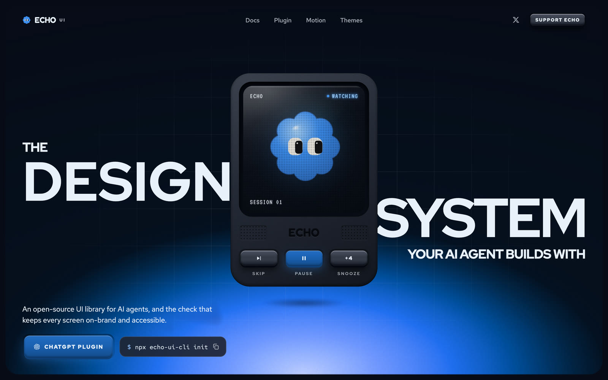
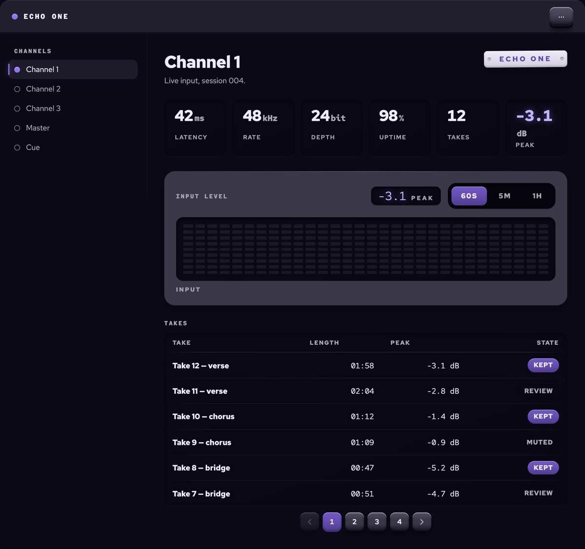
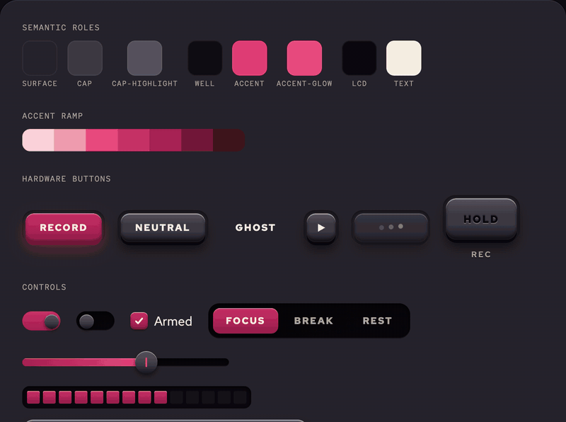
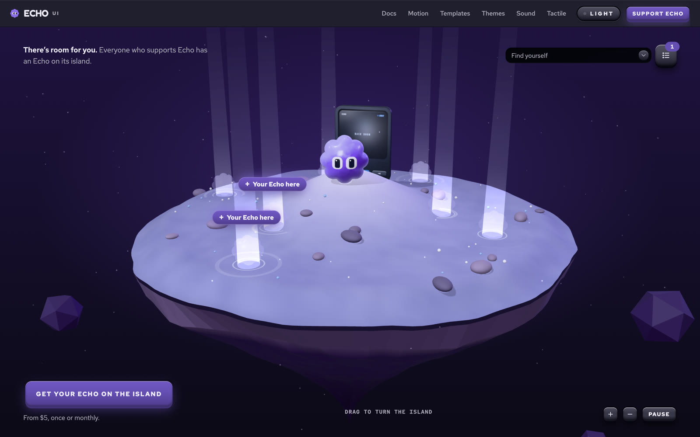

# Echo UI

> Tactile components you can feel. The design system that keeps your AI on-brand.

[](https://echo-ui.com)

Echo is one design system, not a bundle of components. Every part is molded from the same
material and follows the same rules: caps in recessed wells, emissive LCD readouts, real press
travel. One colour themes all of them, and they press, sound and move the same way, so your
product feels like one thing. **Motion and sound are first-class token families alongside colour
and type**, so a button does not just look pressed, it moves and it clicks.

Your style goes on top. Echo keeps the feel (the press, the sound, the motion, the AA floor), and the
look is yours:

1. **Your mood boards become styles.** Echo's Design Eye reads them, asks you what a board can't
   settle, and saves each style to your own private library. A board drawn in line becomes a drawn
   device.
2. **A new app picks its style.** `init` sets the project up, and Style Fit picks the style that fits.
3. **Your agent builds the screen**, asking Echo which component does each job. Changing one
   setting later, like "rounder", is one line: `style set`.
4. **When it slips, Echo hands it back.** A check runs on every file your agent saves, and when it
   says it's done, Echo's tests (design and axe) run on the pages it changed until they pass.
5. **Next product, next style.** The same components and the same feel, in another look.

[The workflow](https://echo-ui.com/docs/workflow) follows one builder through all five.

Echo's components are **copied, not installed**: its CLI puts their source in your repo and you
own it from there. The one npm package is `echo-ui-core`, the small shared grammar they import
(the theme engine, sound, motion and tactile feedback).

```bash
npx echo-ui-cli init
npx echo-ui-cli add hardware-button
```

**115 items**: 113 components (two of them hooks) and 2 whole-screen templates. Every one has a
docs page that is axe-clean, works from the keyboard, runs on Chromium and WebKit in the test
suite, and relights from a single colour seed.

[](https://echo-ui.com/templates/console)

<sub>The Console template, one command: <code>npx echo-ui-cli add console</code>. A rail, six readouts, a level matrix and a table on one screen.</sub>

---

## Browser support

**Chrome/Edge 111+, Safari 16.2+, Firefox 113+.** Declared as a `browserslist` key so a build tool
can read it, and checked on two engines — the test suite runs against Chromium and WebKit.

The floor is `oklch()` and `color-mix()`. Echo's whole colour system derives every surface, every
border and every state from one seed colour, and that derivation happens in CSS at paint time
rather than being precomputed — which is what lets a theme relight from a single value. Those two
functions are how.

Below the floor the failure is silent: an unsupported `color-mix()` makes the whole declaration
invalid rather than falling back, so a surface loses its colour instead of degrading. `createEchoTheme`
therefore emits one `@supports not (color: color-mix(…))` guard that paints plain seed colours on
the page root. An out-of-baseline visitor gets something legible and obviously unstyled rather than
invisible text on an invisible background. There are no per-property fallbacks beyond that, and
there will not be: a flat-colour twin for every `color-mix()` in the library is a second, worse
design system running in parallel forever.

## Install

**Before you start:** a Next.js 16 (App Router) or Vite app on React 18 or later, with TypeScript
(components ship as `.tsx`), and Node 20 or later for the CLI. Nothing else: no CSS framework, no
config file, no path alias. [Installation](https://echo-ui.com/docs/installation) says why each one.

**1. Set the project up** once. This installs `echo-ui-core`, writes `echo.json`, `echo-lock.json`
and `echo-theme.css`, adds what an agent reads (a marked Echo block in `CLAUDE.md` or `AGENTS.md`, a
check hook, the Stop gate and three skills), and prints the lines it wants you to paste yourself:

```bash
npx echo-ui-cli init
```

It never edits your source code, and `add` refuses to run before it. `npx echo-ui-cli agent off`
takes the block, `DESIGN.md`, the hook and the skills back out. The registry it reads defaults to
`https://echo-ui.com/e`; `--registry` points it somewhere else.

**2. Add anything:**

```bash
npx echo-ui-cli add hardware-button   # one component
npx echo-ui-cli add console           # a whole screen
```

A template pulls in every component it uses. Everything lands under a single Echo folder and the
items import each other by relative path, so they resolve identically in this repo and in yours —
no alias to configure. `echo-lock.json` records what was installed, so a file you have edited stops
the next install instead of being overwritten.

---

## What you can count on

- **Updates keep your edits.** Echo records a hash of every file it installs. `npx echo-ui-cli diff`
  says what changed since, and `npx echo-ui-cli update` merges Echo's change into files you've
  edited; where the two meet in the same lines, it shows them and changes nothing.
- **`init` doesn't touch your CSS.** It writes the theme into its own file in the Echo folder and
  prints the one import line for you to paste. Your global CSS and your layout stay yours.
- **Few dependencies.** `echo-ui-core` has none of its own: it asks for React and GSAP, which your
  app installs once. Components add Base UI where they need it, and nothing else.
- **First-party code only.** Every file you install is Echo's own source, in your repository, where
  you can read it. Once the repository is public, the release workflow publishes each package with
  npm provenance, so a version can be traced to the commit it was built from; until then, releases
  are published by hand.
- **Accessible, and kept that way.** Every component is tested against WCAG 2.2 AA: axe, keyboard,
  focus-visible, forced-colors, target-size, reflow. `npx echo-ui-cli check` keeps an agent from
  undoing it in the screens it builds: unnamed controls, clicks with no keyboard, images without alt
  text, removed focus rings. What a check can't judge still needs a person: the reading order, and
  whether a name makes sense. Still open: screen-reader, not yet verified by a person.

## What's in it

**`echo-ui-core`** — the theme engine, the sound engine, motion tokens, `useTactile`,
`useGsapPresence`. **Foundations** — SizeProvider, and Scope (a colour of its own for one part of
the page).

**Buttons** (4) — HardwareButton, LedKey, Toggle, Toolbar.

**Forms** (21) — Field, Textarea, Select, Combobox, TagsInput, Checkbox, CheckboxGroup, RadioGroup,
ChoiceCards, Switch, Slider, RangeSlider, NumberField, OTP field, DateField, Calendar, DatePicker,
FileUpload, Segmented, Fieldset, Form.

**Overlays** (7) — Modal, AlertDialog, Sheet, Menu + ContextMenu, Popover, Tooltip, **Command** (a
dot-matrix command palette).

**Navigation** (7) — SideNav, TabBar, Tabs, Breadcrumb, Pagination, Steps, Link.

**Layout** (11) — AppShell, Stack & Grid, Panel, Card, Item, Divider, Accordion, Collapsible,
ScrollArea, WidgetGrid, PullToRefresh.

**Data display** (11) — Table, DescriptionList, StatTile, LcdChip, **Chart** (a readout, not a
charting library), Badge, CountBadge, Tag, Avatar, Kbd, ShortcutMap.

**Feedback** (10) — Toast, Banner, Progress, Meter, Loader, Skeleton, StatusDot, EmptyState,
NotificationCenter, StatusIsland.

**Objects** (18) — the hardware only Echo has: Knob, Tuner, JogWheel, Keypad, FillSlider,
QuickTile, SwitchBank, PatchBay, FilterTray, WeekStrip, LevelMeter, SegmentDisplay, DateTile,
Annunciator, EngravedPlate, Receipt, Ticket, NowPlaying.

**Motion** (18) — HoldButton, Morph, DoneButton, ConfirmButton, SaveButton, ActionFan, Timer,
Stopwatch, VoiceNote, AddToBag, PullCord, SplitFlap, LightSource, Magnetic, ThrowStack, Ripple, and
the hooks `useBudOff` and `useRoll`.

**Creature** (2) — Creature, the companion that reports what's happening, and Perch.
**Texture** (2) — dither, noise, halftone, scanlines and grain overlays, and ShaderField.

**Templates** — whole screens, installable as one block:

| Block | Proves |
| --- | --- |
| `echo-console` | Density and data at scale. Whether the material language holds when nothing has room. |
| `echo-chat` | That the material survives running text: incoming messages get no container, and the only raised object is Send. |

---

## Theming

One seed in, the whole device relights:

[](https://echo-ui.com/generator)

<sub>Four seeds from the <a href="https://echo-ui.com/generator">theme generator</a>: Nawwara, Raspberry, Coral and Sky.</sub>

```tsx
import { createEchoTheme } from "echo-ui-core/theme";

const { css, values } = createEchoTheme({ accent: "#3D8EF0" });
```

Every Layer-3 `--echo-*` role is derived in OKLCH from a ~3-value seed, with a 7-stop accent ramp
and a JS mirror for GSAP and canvas. Text roles are contrast-guarded to WCAG AA against **every**
ground they are used on; a seed whose constraints cannot all be met is reported rather than silently
shipped.

**Echo is dark or light, and the chassis decides.** A dark chassis makes a device with lit
screens: recessed glass whose readouts glow. A pale one makes a light device, like a white
calculator: screens of paper glass printed in ink, because a glow on a pale body is a smudge; the
accent lit on it, with lit text printed a step deeper; the same primary cap, with a light label;
shadows of the body's own colour; and a lit rim that stops short of white, so a cap keeps its bevel.
It isn't a mode to switch: one seed makes one device, and both are held to the same contrast
guarantee.

## Sound

Sound tokens are serializable synth recipes rendered by a zero-dependency WebAudio backend — no
audio assets. `SoundProvider` handles the parts that are easy to get wrong: no AudioContext until a
user gesture, persisted mute, a blur guard, and coupling to `prefers-reduced-motion`.

## For agents

Echo is built to be used through a coding agent, and `init` makes the project say so. It writes a
short Echo block into `CLAUDE.md` or `AGENTS.md`, which Claude Code, Codex and Cursor read at the
start of every session; a hook that runs `npx echo-ui-cli check` on every file the agent edits and
hands what it finds straight back; the Stop gate, which runs Echo's tests (the design tests and
axe) on the pages the agent changed before it can call the work done; an Echo skill with the steps for building a screen from Echo's
reference screens; Echo's Design Eye, which reads a moodboard into a style the project can wear,
saved to the builder's own private library; and Echo's Style Fit, which picks the style a product
wears from that library and Echo's. [What Echo puts in your project](https://echo-ui.com/docs/in-your-project)
lists each one, and `npx echo-ui-cli agent off` takes them out.

The agent asks before it writes, several questions at once, answered offline from a copy of the
catalog in the project:

```bash
npx echo-ui-cli which "a settings toggle" "confirm a delete"
npx echo-ui-cli docs switch alert-dialog
```

For tools without a terminal, the same records are published: every component's props, examples
and anti-patterns as data, so a model is told that a screen readout does not ease smoothly and that
severity is not red/amber/green.

- [`/llms.txt`](https://echo-ui.com/llms.txt) · [`/llms-full.txt`](https://echo-ui.com/llms-full.txt) · [`/r/catalog.json`](https://echo-ui.com/r/catalog.json)
- An MCP server over the same catalog, run with `npx -y echo-ui-mcp` or hosted at
  `https://mcp.echo-ui.com/mcp` for the tools without a terminal: `search_components`,
  `get_component`, `get_tokens`, `get_examples`, `get_accessibility`, `check_code`, and four for
  styles, `list_styles`, `fit_styles`, `check_style` and `wear_style`. See
  [`mcp/README.md`](./mcp/README.md).
- The docs site has a guide for each: [For AI agents](https://echo-ui.com/docs/ai),
  [Installation](https://echo-ui.com/docs/installation), [MCP server](https://echo-ui.com/docs/mcp)
  and more.

---

## Contributing

See [CONTRIBUTING.md](./CONTRIBUTING.md) for the development workflow and the rules a change has to
meet. The short version: Echo's architecture is **locked** — the stack, the three-layer token
model, and the copy-into-your-tree distribution were each decided with the tradeoffs weighed.
CONTRIBUTING lists them. A change that needs one of them re-decided is an issue, not a pull
request.

## Support Echo

Echo is free, and it stays free. If it saves you time, one-time or monthly support pays for new
components, bug fixes and releases: [echo-ui.com/support](https://echo-ui.com/support). Starring the
repository and reporting bugs help too.

[](https://echo-ui.com/supporters)

<sub>Everyone who supports Echo gets an Echo of their own on <a href="https://echo-ui.com/supporters">its island</a>, with their name and their links.</sub>

## License

MIT — see [LICENSE](./LICENSE). Components, blocks and the agent layer are all MIT; nothing here is a
paid tier. Installed components are copied into your repo and are yours to change.
